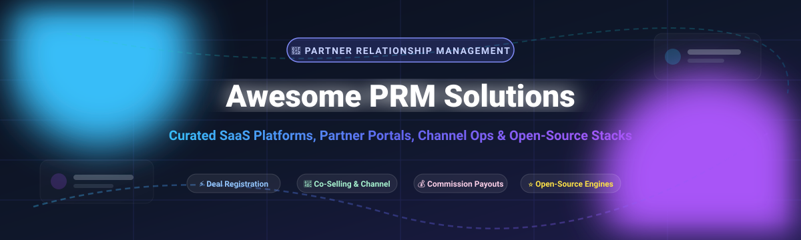

<p align="center">
  
</p>

<p align="center">
  <a href="https://github.com/ishandutta2007/Awesome-Awesome-Awesome"></a><a href="https://discord.gg/jc4xtF58Ve"></a>
  <a href="https://github.com/ishandutta2007/Awesome-Partner-Relationship-Management-Prm/stargazers"></a>
  <a href="https://github.com/ishandutta2007/Awesome-Partner-Relationship-Management-Prm/forks"></a>
  <a href="https://github.com/ishandutta2007/Awesome-Partner-Relationship-Management-Prm/blob/main/LICENSE"></a>
  <a href="https://github.com/ishandutta2007/Awesome-Partner-Relationship-Management-Prm/pulls"></a>
  <a href="https://github.com/ishandutta2007"></a>
</p>

---

# 🤝 Awesome Partner Relationship Management (PRM) & Channel Operations

> **A comprehensive, SEO-optimized curated directory of top SaaS platforms and open-source GitHub alternatives for Partner Relationship Management (PRM), Channel Sales, Reseller Portals, Affiliate Orchestration, Deal Registration, and Co-Selling Ecosystems.** 🚀

**Partner Relationship Management (PRM)** software helps businesses onboard, train, manage, and collaborate with third-party channel partners—including value-added resellers (VARs), system integrators (SIs), affiliates, referral partners, distributors, and strategic alliances. PRM systems bridge internal CRM pipelines with external partner portals to accelerate co-selling, automate deal registration, prevent channel conflict, and distribute commission payouts.

---

## 📑 Table of Contents
- [🎯 Core Capabilities of PRM](#-core-capabilities-of-prm)
- [🏢 SaaS & Commercial Hosted Platforms](#-saas--commercial-hosted-platforms)
- [⭐ Open-Source GitHub Alternatives](#-open-source-github-alternatives)
- [🏗️ PRM Architecture for Self-Hosted Deployments](#️-prm-architecture-for-self-hosted-deployments)
- [🔍 SEO & Comparison Keywords](#-seo--comparison-keywords)
- [🤝 How to Contribute](#-how-to-contribute)
- [💖 Support](#-support)
- [📈 Star History](#-star-history)
- [⚖️ License & Disclaimer](#️-license--disclaimer)

---

## 🎯 Core Capabilities of PRM

Modern PRM and ecosystem platforms streamline every stage of indirect sales channels:
- 🚪 **Partner Onboarding & Portals**: Branded self-service hubs, contract execution, compliance checks, and tier-based partner profiles.
- 📝 **Deal Registration & Lead Distribution**: Structured dispute-free deal registration, lead dispatching, and pipeline status updates with bi-directional CRM syncing.
- 🎓 **Partner Training & Enablement (LMS)**: Certification modules, co-branded asset libraries, playbook distribution, and product training tracks.
- 🤝 **Co-Selling & Ecosystem Account Mapping**: Overlapping customer discovery, cross-company pipeline collaboration, and warm intro orchestration.
- 💸 **Incentives & Commission Payouts**: Automated calculation of referral finder fees, MDF (Market Development Funds), performance spiffs, and payout processing.

---

## 🏢 SaaS & Commercial Hosted Platforms

> **Market Analysis & Industry Structure**: The global Partner Relationship Management (PRM) software market is estimated at **$1.8B – $2.4B in 2026** (growing at an ~14.5% CAGR toward $4B+ by 2030). The market exhibits **moderate fragmentation with high tier-1 consolidation**: mega-cap CRM titans (Salesforce) command dominant enterprise mindshare, alongside well-funded multi-stage specialists (Impact.com, Impartner, PartnerStack) leading mid-market and affiliate/B2B ecosystems, while specialized niche portals serve long-tail channel verticals.

*Commercial PRM platforms sorted in descending order by parent company size (Annual Revenue / Valuation / Market Cap).*

| 🏛️ Platform | 💼 Company Size (Revenue / Valuation) | 📝 Description | 💵 Starting Pricing | 🎁 Free Tier / Trial Limits |
| :--- | :--- | :--- | :--- | :--- |
| **[Salesforce PRM (Experience Cloud)](https://www.salesforce.com/products/sales-cloud/tools/partner-relationship-management/)** | **~$38B Revenue / ~$280B Market Cap** *(NYSE: CRM)* | Enterprise-grade partner community engine built natively on Salesforce CRM; automates lead sharing, deal registration, MDF workflows, and tiered co-selling. | **$10 per member / month** *(or $25 / login for Member / Login-based Community licenses, billed annually)* | **No free tier**; **30-day free trial** of Salesforce Sales Cloud / Experience Cloud demo environment with sample channel data |
| **[Impact.com](https://impact.com/)** | **~$200M+ ARR / ~$1.5B+ Valuation** | Leading global partnership automation platform managing publishers, affiliate networks, influencer programs, and strategic B2B referral partners. | **$500 / month** *(Impact Starter edition + 3% payment processing fee)* | **No free tier**; **Guided live interactive sandbox demo** upon request with technical onboarding evaluation |
| **[Impartner PRM](https://impartner.com/)** | **~$80M – $100M ARR / ~$500M+ Valuation** | Pure-play enterprise PRM suite offering modular partner portals, Deal Registration, PRM Copilot AI, automated tiering, and Channel POS tracking. | **$2,000 / month** *(Impartner Growth tier, typically billed annually at ~$24,000/yr)* | **No free tier**; **Guided 1-on-1 personalized sandbox demo** with custom ecosystem workflow evaluation |
| **[PartnerStack](https://partnerstack.com/)** | **~$50M – $70M ARR / ~$450M Valuation** | Dedicated B2B SaaS partner ecosystem engine uniting affiliate, referral, and reseller programs with automated commission payouts and a 80,000+ partner marketplace. | **$1,500 / month** *(PartnerStack Essentials package, billed annually)* | **No free tier**; **Guided live product tour and partner network matching consultation** on request |
| **[Allbound PRM](https://www.allbound.com/)** | **~$20M – $30M ARR / ~$120M Valuation** | Channel-first PRM platform focused on partner lifecycle engagement, content co-branding, deal registration, and playbook certification. | **$1,200 / month** *(Allbound Standard edition for up to 100 active partner users)* | **No free tier**; **14-day guided proof-of-concept trial** available post-consultation |
| **[Channeltivity](https://www.channeltivity.com/)** | **~$15M – $25M ARR / ~$90M Valuation** | Intuitive, turnkey PRM software designed specifically for high-growth tech companies with built-in HubSpot and Salesforce bi-directional integrations. | **$1,399 / month** *(Standard Edition with unlimited partner users, flat monthly fee billed annually)* | **No free tier**; **30-day interactive evaluation sandbox** provided following a live architecture walkthrough |
| **[Zinfi PRM](https://www.zinfi.com/)** | **~$15M – $25M ARR / ~$80M Valuation** | Unified partner management platform delivering channel marketing automation (TCMA), partner onboarding, deal registration, and incentives governance. | **$1,000 / month** *(Core PRM module base platform fee)* | **No free tier**; **30-day pilot testing sandbox** available for enterprise procurement teams |
| **[Magentrix PRM](https://www.magentrix.com/)** | **~$10M – $15M ARR / ~$60M Valuation** | Customizable partner & customer portal software with seamless bi-directional synchronization for Salesforce, HubSpot, and Microsoft Dynamics 365. | **$1,199 / month** *(Magentrix Standard Portal package including up to 100 partner users)* | **No free tier**; **15-day full-feature trial sandbox** with sample partner workflows and CRM test sync |
| **[Webinfinity (360insights)](https://www.webinfinity.com/)** | **~$25M+ ARR / ~$150M Valuation** *(360insights Group)* | Enterprise digital engagement engine providing customized channel partner portals, personalized asset hubs, and unified co-selling dashboards. | **$1,500 / month** *(Modular deployment baseline for mid-market channel programs)* | **No free tier**; **Custom interactive portal sandbox demo** tailored to partner tiering models |
| **[Kiflo PRM](https://www.kiflo.com/)** | **~$3M – $6M ARR / ~$25M Valuation** | Modern, accessible PRM platform tailored for SMBs and scale-ups managing affiliate, referral, and reseller partners with native HubSpot sync. | **$299 / month** *(Kiflo Starter tier; $599/mo for Professional tier, billed annually)* | **No free tier**; **14-day free trial** with full access to partner onboarding, link tracking, and deal registration |

---

## ⭐ Open-Source GitHub Alternatives

> **Deploying Self-Hosted & Extensible Partner Portals**: While specialized PRM SaaS charges high monthly platform fees, development teams increasingly assemble custom, audit-proof, and cost-effective partner portals using modern open-source stacks, modular CRMs, low-code portal builders, and head-less database engines.

*Open-source repositories sorted descending by GitHub stargazers count with official social badges.*

| 📦 Open-Source Project | 🌟 GitHub Stars | 💻 Tech Stack | 🤝 PRM, Portal & Channel Capabilities |
| :--- | :--- | :--- | :--- |
| **[NocoDB](https://github.com/nocodb/nocodb)** | [](https://github.com/nocodb/nocodb/stargazers) | TypeScript, Node.js, Vue.js, PostgreSQL/MySQL | Open-source Airtable alternative; perfect for building relational deal registration tables, partner directory management, referral tracking, and role-based views. |
| **[Twenty](https://github.com/twentyhq/twenty)** | [](https://github.com/twentyhq/twenty/stargazers) | TypeScript, NestJS, React, GraphQL, PostgreSQL | Modern open-source CRM alternative to Salesforce; custom partner entities, deal pipeline kanbans, multi-tier relationship graphs, and REST/GraphQL APIs. |
| **[Odoo Community](https://github.com/odoo/odoo)** | [](https://github.com/odoo/odoo/stargazers) | Python, JavaScript, XML, PostgreSQL | Full-featured open-source ERP/CRM suite; includes a dedicated Reseller Portal module, commission tracking, lead forwarding, quotation generators, and customer billing. |
| **[Cal.com](https://github.com/calcom/cal.com)** | [](https://github.com/calcom/cal.com/stargazers) | TypeScript, Next.js, Prisma, Tailwind CSS | Self-hosted scheduling infrastructure used for partner onboarding calls, joint deal co-selling reviews, channel manager office hours, and routing forms. |
| **[ToolJet](https://github.com/tooljet/tooljet)** | [](https://github.com/ToolJet/ToolJet/stargazers) | TypeScript, React, NestJS, PostgreSQL | Open-source low-code internal tool framework; rapidly construct secure partner portals, deal approval dashboards, payout disbursement panels, and CRM sync tools. |
| **[ERPNext](https://github.com/frappe/erpnext)** | [](https://github.com/frappe/erpnext/stargazers) | Python, Frappe Framework, MariaDB | Complete open-source business OS featuring a native Partner and Sales Partner doctype, commission structures, reseller pricing rules, and a self-service portal. |
| **[Directus](https://github.com/directus/directus)** | [](https://github.com/directus/directus/stargazers) | TypeScript, Node.js, Vue.js, SQL | Real-time headless data platform and BaaS; build custom white-labeled partner extranets with fine-grained granular permissions, webhooks, and automation flows. |
| **[Chatwoot](https://github.com/chatwoot/chatwoot)** | [](https://github.com/chatwoot/chatwoot/stargazers) | Ruby on Rails, Vue.js, PostgreSQL | Omnichannel communication platform; equips channel managers with direct chat, ticketing, and real-time support across partner portal embedded widgets. |
| **[Formbricks](https://github.com/formbricks/formbricks)** | [](https://github.com/formbricks/formbricks/stargazers) | TypeScript, Next.js, Prisma, Tailwind CSS | Privacy-first form and survey suite; manage partner onboarding applications, deal submission forms, satisfaction ratings, and compliance checks. |
| **[GLPI](https://github.com/glpi-project/glpi)** | [](https://github.com/glpi-project/glpi/stargazers) | PHP, MariaDB / MySQL | Open-source asset, contract, and vendor relationship management software with multi-entity isolation and role-restricted external supplier/partner access. |
| **[SuiteCRM](https://github.com/salesagility/SuiteCRM)** | [](https://github.com/salesagility/SuiteCRM/stargazers) | PHP, MariaDB / MySQL | Enterprise open-source CRM alternative; robust role management, quotes, lead allocation rules, contracts, and external partner self-service access via Joomla/portal connectors. |
| **[EspoCRM](https://github.com/espocrm/espocrm)** | [](https://github.com/espocrm/espocrm/stargazers) | PHP, MySQL, Backbone.js | Fast, customizable CRM software with a native **Portal feature** enabling external partner users to view leads, register deals, and submit support inquiries. |
| **[FOSSBilling](https://github.com/fossbilling/fossbilling)** | [](https://github.com/fossbilling/fossbilling/stargazers) | PHP, Twig, MySQL | Open-source billing, invoicing, client management, and affiliate tracking suite; ideal for automated reseller invoicing and partner commission ledgering. |

---

## 🏗️ PRM Architecture for Self-Hosted Deployments

To build a secure, compliant, and scalable self-hosted Partner Relationship Management architecture, combine best-of-breed open-source modules:

```
┌────────────────────────────────────────────────────────────────────────┐
│                      External Partner Touchpoints                      │
│      (Resellers, Solution Providers, Strategic ISVs, Affiliates)       │
└──────────────────────────────────┬─────────────────────────────────────┘
                                   │
                                   ▼
┌────────────────────────────────────────────────────────────────────────┐
│                   Secure Extranet & Portal Interface                   │
│        • ToolJet / Directus Webhook Engine / EspoCRM Portal            │
│        (Role-based access, deal submission, asset downloads)           │
└──────────────────────────────────┬─────────────────────────────────────┘
                                   │
                                   ▼
┌────────────────────────────────────────────────────────────────────────┐
│                   Deal Registration & Pipeline Logic                   │
│         • Twenty CRM / ERPNext / SuiteCRM Workflow Engine              │
│       (Duplicate check, lead dispatching, co-sell status sync)         │
└──────────────────────────────────┬─────────────────────────────────────┘
                                   │
                                   ▼
┌────────────────────────────────────────────────────────────────────────┐
│                 Payout, Invoicing & Analytics Engine                   │
│         • FOSSBilling / NocoDB / Superset Reporting Ledger             │
│        (Commissions, MDF distribution, audit trail compliance)         │
└────────────────────────────────────────────────────────────────────────┘
```

- 🔑 **Identity & Access**: Enforce OAuth2 / SAML single sign-on with role-based permissions so partners only access assigned customer opportunities.
- 🛡️ **Conflict Prevention**: Implement automated timestamped validation on deal registration to protect partner margins and prevent sales collisions.
- 📊 **Ledger Syncing**: Trigger automated webhooks to billing engines to calculate tier-based margins and process referral spiffs transparently.

---

## 🔍 SEO & Comparison Keywords

*This repository indexes tools, frameworks, and topics associated with:*

`Partner Relationship Management` • `PRM Software` • `Channel Management Platform` • `Salesforce PRM Alternative` • `Impartner Alternative` • `PartnerStack Competitors` • `Open Source PRM` • `Open Source Channel Portal` • `Deal Registration Software` • `Co-Selling Software` • `Partner Portal Open Source` • `Ecosystem-Led Growth (ELG)` • `Affiliate Management System` • `Reseller Portal Software` • `Channel Sales Enablement` • `Partner Onboarding Automation` • `Market Development Funds (MDF) Tracking` • `B2B Referral Software`

---

## 🤝 How to Contribute

Contributions, tool suggestions, and documentation refinements are very welcome!

1. 🍴 **Fork** this repository.
2. 🌿 **Create a branch**: `git checkout -b add-prm-solution`
3. 📝 **Edit `README.md`**: Follow the established table format with verified starting pricing, strict free tier/trial limits, company size metrics, and GitHub social star badges.
4. 🚀 **Commit & Push**: `git commit -m "Add [Tool Name] to PRM directory"`
5. 📬 **Submit a Pull Request** with a description of the channel tool.

Explore more curated developer lists at [Awesome-Awesome-Awesome](https://github.com/ishandutta2007/Awesome-Awesome-Awesome).

---

## 💖 Support

Thank you for visiting this repository! If this curated list of Partner Relationship Management tools helps you build, scale, or automate your channel ecosystem:

- ⭐ **Star this repository** to show your appreciation and bookmark it for later.
- 🍴 **Fork and share** with fellow channel leaders, alliance managers, and developers.
- ☕ **Buy a coffee & sponsor**: Support ongoing open-source maintenance via the [GitHub Sponsor Dashboard](https://github.com/sponsors/ishandutta2007).

---

## 📈 Star History

[](https://star-history.dera.page/#ishandutta2007/Awesome-Partner-Relationship-Management-Prm&type=date&legend=top-left)

---

## ⚖️ License & Disclaimer

- Distributed under the [MIT License](https://github.com/ishandutta2007/Awesome-Partner-Relationship-Management-Prm/blob/main/LICENSE).
- All trademarks, registered logos, and company names mentioned in this project are the property of their respective owners.
